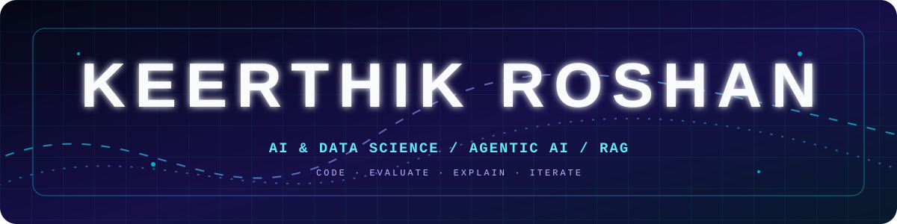

<!--
  ROZN // GITHUB PROFILE README
  Save as README.md in the public repository named KeerthikRoshan7.
-->

<div align="center">



<br/>

<a href="https://git.io/typing-svg">
  
</a>

<br/><br/>

<a href="https://komarev.com/ghpvc/?username=KeerthikRoshan7">
  
</a>
<a href="https://github.com/KeerthikRoshan7?tab=followers">
  
</a>
<a href="https://keerthikroshan-portfolio.netlify.app">
  
</a>

</div>

---

## `> who.am.i`

```text
NAME      : Keerthik Roshan G // ROZN
ROLE      : B.Tech Artificial Intelligence & Data Science
COLLEGE   : M.I.E.T. Engineering College, Tiruchirappalli
FOCUS     : Agentic AI · Multi-Agent Systems · RAG · Applied ML
CURRENT   : Building retrieval-grounded, explainable AI systems
```

I'm an AI & Data Science undergraduate interested in building **explainable, retrieval-grounded AI**—especially systems that need to connect model outputs to evidence. My work spans multi-agent orchestration, computer vision, semantic retrieval, data analysis, and full-stack ML prototypes.

I care about more than a model's headline metric: I want to understand the pipeline, evaluate it carefully, and make its outputs easier to inspect and trust.

> *Build the system. Ground the answer. Explain the result.*

---

## `> education`

<div align="center">


<br/><br/>

**M.I.E.T. Engineering College · Tiruchirappalli**  
September 2023 – Present

<sub>Relevant coursework: Data Science & Analysis · Machine Learning & Deep Learning · Artificial Intelligence</sub>

</div>

---

## `> focus_areas`

<div align="center">

| `01` — INTELLIGENCE | `02` — RETRIEVAL & REASONING | `03` — APPLIED ENGINEERING |
| :---: | :---: | :---: |
| Machine Learning | Retrieval-Augmented Generation | Data analysis & visualization |
| Deep Learning | Multi-Agent Systems | ML pipelines & deployment |
| Computer Vision | LLM orchestration | Semantic search & vector stores |
| Agentic AI | Evidence-grounded generation | Offline-first AI prototypes |

</div>

---

## `> tech_stack --visual`

<div align="center">

#### Languages & Data


<br/>

#### ML, Applications & Infrastructure

<a href="https://skillicons.dev">
  
</a>

<br/>

#### AI & Retrieval Ecosystem

`Google Gemini SDK` · `FAISS` · `ChromaDB` · `Ollama` · `LLaVA` · `CLIP` · `faster-whisper` · `BioBERT / ClinicalBERT` · `Pydantic`

<br/>

<sub>Stack reflects tools and technologies used in coursework, internships, or projects; proficiency varies by tool.</sub>

</div>

---

## `> experience.log`

### Research Intern — NIT Tiruchirappalli
<sub>Summer Internship Program · Vortex '26 · Jun 2026 – Jul 2026</sub>

- Contributed to **DR-MARVEL**, a multi-agent, retrieval-augmented framework for diabetic retinopathy decision support.
- Owned agent-level design and evaluation methodology, coordinating architecture reviews and validation with a faculty mentor.
- Worked on evidence-grounded clinical reporting using ophthalmology guidelines and biomedical literature sources.

### Data Science Intern — DigiDARA Technologies
<sub>Trichy (Hybrid) · Jul 2025 – Aug 2025</sub>

- Practised Python, NumPy, Pandas, and SQL through hands-on microprojects.
- Performed end-to-end exploratory data analysis on a loan-approval dataset and identified predictive features for creditworthiness modelling.

---

## `> projects --featured`

<div align="center">

<a href="https://github.com/KeerthikRoshan7/DR-MARVEL"></a>
<a href="https://github.com/amalbal21/RetVNX"></a>

<a href="https://github.com/KeerthikRoshan7/Aequilex-Py"></a>
<a href="https://github.com/KeerthikRoshan7/PneumoNet"></a>

</div>

<br/>

### DR-MARVEL
**Multi-Agent RAG-Augmented, Vision-Grounded, Explanatory Lesion Analysis for Diabetic Retinopathy**

- Co-designed a clinical decision-support framework with five specialized agents: lesion analysis, evidence retrieval, diagnostic reasoning, referral recommendation, and explainability.
- Built a retrieval-grounded knowledge workflow using FAISS, BioBERT/ClinicalBERT embeddings, AAO/ICO guidelines, and federated literature retrieval from PubMed, Europe PMC, and ClinicalTrials.gov.
- Resume-reported evaluation: **96.72% accuracy, 95.97% F1-score, and 0.988 AUC** across EyePACS, APTOS, IDRiD, and Messidor (94K+ fundus images).

### RetVNX
**Multimodal Semantic Video Retrieval for CCTV / Surveillance Footage** · IEEE-judged hackathon

- Designed a four-stage retrieval pipeline using MobileViT-XXS for frame filtering, CLIP and faster-whisper embeddings for multimodal indexing, and a ChromaDB HNSW vector store.
- Designed an Ollama + LLaVA query-intent router for four retrieval modes.
- Built for fully offline operation to meet the hackathon's no-internet-dependency demo requirement; owned system documentation and architecture within a four-person team.

### AEQUILEX
**AI-Powered Legal Research Assistant**

- Built a strict-citation research engine grounded in verified IPC and BNS/BNSS statutes, using semantic retrieval across multilingual documents.
- Developed document ingestion with PyPDF2 and document generation with python-docx, plus multilingual translation.
- Deployed as a full-stack single-file application on Streamlit Cloud.

### PneumoNet
**Attention-Based DenseNet for Pneumonia Classification**

- Integrated channel and spatial attention into a DenseNet backbone to focus on lung tissue and filter anatomical noise.
- Trained on NIH ChestX-ray14 (112,120 images); resume-reported results: **94.2% accuracy and 93.5% recall**.
- Used Grad-CAM visualizations to inspect model focus regions.

<div align="center">

<a href="https://github.com/KeerthikRoshan7?tab=repositories">
  
</a>

</div>

---

## `> github.stats --live`

<div align="center">

<a href="https://github.com/KeerthikRoshan7">
  
</a>
<a href="https://github.com/KeerthikRoshan7">
  
</a>

<br/><br/>

<a href="https://streak-stats.demolab.com">
  
</a>

<br/><br/>


</div>

---

## `> achievements.unlock()`

- **1st Place** — Connexions (four national symposiums)
- **1st Place** — Key Quest @ KRCE
- **Workshop** — Agentic & Generative AI, Ditto Security @ NIT Trichy (March 2026)
- **Courses** — Python, Python Crash Course, Python for Data Science (Lernx)

---

## `> beyond.the.terminal`

Music, drawing, visual design, and creative experiments keep me curious outside the ML pipeline. I like technical work that has both a clear engineering foundation and a creative point of view.

---

## `> connect --open-channel`

<div align="center">

<a href="https://www.linkedin.com/in/keerthikroshan">
  
</a>
<a href="https://keerthikroshan-portfolio.netlify.app">
  
</a>
<a href="mailto:gkrosh.0712@gmail.com">
  
</a>
<a href="https://github.com/KeerthikRoshan7">
  
</a>

<br/><br/>

**Interested in AI/ML, research-driven engineering, and thoughtful collaboration.**

<br/>


<sub><code>ROZN © 2026 · grounded in evidence, driven by curiosity</code></sub>

</div>
